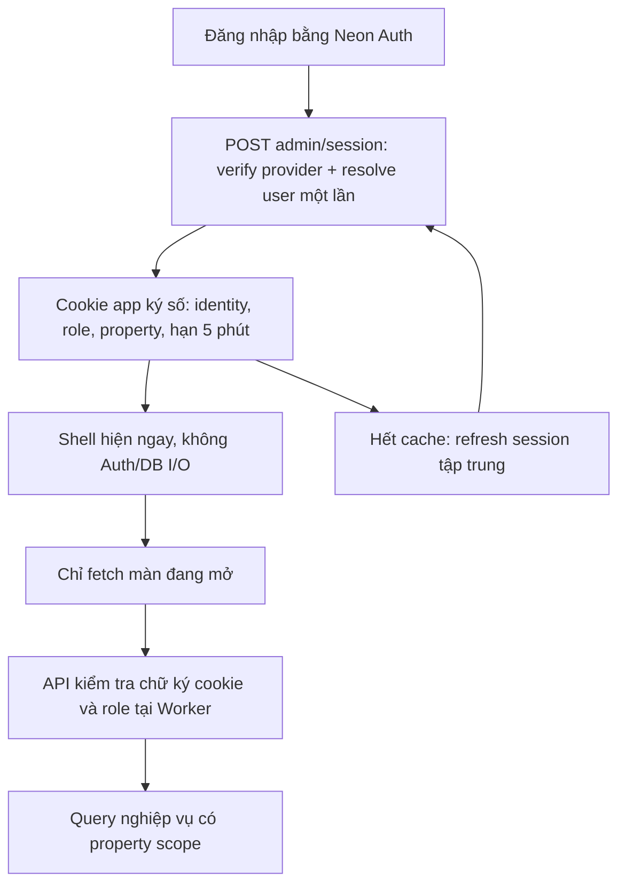

# Handoff dev — admin nội bộ nhanh, session cache, tải theo màn hình

> **Bản yêu cầu mới thay thế thiết kế cũ**, theo xác nhận của chủ hệ thống: khoảng 3 người dùng, 2 vai trò nghiệp vụ; ưu tiên thao tác nhanh và lưu thông tin; hợp đồng gốc lưu ngoài hệ thống.
> Chỉ cập nhật handoff, **chưa sửa/deploy application**. Repo `/Users/suntech/le-grande-center`, `dev` tại `a40ea85a71c899b8a2d9931a1c4295963ff2ddb3`.
> GitNexus/LSP không khả dụng; findings **source-derived**. Source đã đối chiếu với bản trước: không có cited path thay đổi. Evidence schema 2, 49 paths, dirty digest `0a9c85780067d9afcd0764f307b60891e3cee927ee11eaeb5ec7826d10fd82cd`.
> [verified] = source/HAR/offline output; [INFERENCE] = suy luận, không phải benchmark live; phần thiết kế là **đề xuất triển khai**, không phải trạng thái hiện hữu.

## 1. Objective — quyết định sản phẩm mới

**Chọn:** giữ Neon/Auth/storage hiện có; session + role snapshot trong cookie ký số; API kiểm tra cookie tại Worker, không gọi Auth/allowlist trên từng lượt tải; màn nào mở mới tải màn đó; Media phân trang server; không bắt upload hợp đồng.

**Bỏ mục tiêu cũ:** 2 fresh provider checks/request, policy engine/per-row access-decision audit cho admin nhỏ, independent audit transaction cho mỗi lượt đọc, full `AdminSnapshot`, và kế hoạch chỉ lazy-load sau cùng. Không triển khai shared-Pool/two-client audit theo bản cũ.

**Không bỏ:** kiểm tra session signature/expiry ở API, 2-role gate phía server, property scope trong SQL, validation/origin checks, transaction/CAS/idempotency/chống trùng lịch–mặt bằng, lịch sử thay đổi nghiệp vụ. “Login khó một lần” không có nghĩa API công khai hoặc tin role từ localStorage.

## 2. Current Behaviour — bằng chứng cần biết

[verified] HAR `/Users/suntech/Downloads/log-admin.har`, SHA-256 `4b0766510aba3df8c040b32118b9351b524d6df1efad008d46c278f553e0c5de`, một phiên 46 requests:

| Request | Total ms | Wait ms |
|---|---:|---:|
| Admin HTML | 5812.27 | 4128.28 |
| Workspace API | 2820.14 | 2809.63 |
| Staff API, body 2 byte | 3864.21 | 3849.47 |
| Companies | 2396.51 | 2386.53 |
| Leads list | 2701.39 | 2682.75 |
| Appointments | 1266.89 | 1255.87 |

Workspace hoàn tất khoảng 9.428 s, badge 11.306 s tính từ navigation. 4.227 MB là cả phiên; các request khởi phát đến badge chỉ 1.735 MB decoded / 593 KB transferred. Không có application Server-Timing; chưa biết tỷ trọng Auth/DB/connect/CPU và chưa xác nhận deploy HAR đúng HEAD trên.

[verified, source-derived] Những chỗ đang gây coupling:
- `src/server/auth.ts:25–44`, `database.ts:42–83`, `admin-crud.ts:40–72,259–265`: workspace/collection thành công đi qua 3 provider verifies, 3 transaction/pool; staff chỉ 1 verify + 2 transaction. `packages/backend/src/access.ts:62–133` có final remote recheck/audit cố ý theo contract cũ.
- `workspace.ts:54–69`: base query + companies/appointments/leads, media/storage được gom vào một snapshot. `workspace.ts:268–286` và `media/repository.ts:132–226`: **mutation/replay cũng đọc lại full snapshot**.
- `use-admin-data.ts:23–50` tải workspace ở mount; `admin-collections.tsx:30–44` bắt collection đợi global revision. Chỉ tách JS chunk không xóa waterfall này.
- `media/repository.ts:26–37` query toàn bộ media rồi nối toàn bộ `projectMedia()`. `admin-records.tsx:97–118` filter/paginate trên browser; dòng 99 tự chọn item đầu và dòng 121 mount preview gốc. Catalog project hiện có 29 entries + 1 video; tải ảnh gốc/preview và coupling mới là vấn đề rõ, không phải JSON catalog 4.9 KB tự nó rất lớn.
- `app/layout.tsx:59–70` đợi public DB projection; `src/proxy.ts:4–8` chạy Neon middleware; login/shell còn phụ thuộc public provider qua `admin-entry.tsx:32`, `le-grande-admin-shell.tsx:10`.
- `workspace.ts:239–245` bắt `recordDocument`; `b2b-model.ts:23–24`, `parse-command.ts:45` bắt mediaId; migration `001-live-workspace.sql:39–49` **DB cũng bắt private PDF** để lease executed. Chỉ bỏ form upload sẽ làm nghiệp vụ ghi nhận thuê lỗi.

## 3. Relevant Architecture — thiết kế đích



- Cookie cache **5 phút cố định**, không sliding gia hạn bằng cookie cũ. Hết 5 phút không buộc nhập lại password nếu managed session còn sống; chỉ refresh nền/qua loader nhỏ.
- Session API trả thông tin user/role/expiry tối thiểu, không snapshot nghiệp vụ. Browser cache dữ liệu theo màn/filter/page trong memory **60 giây**, không lưu dữ liệu private/token trong localStorage.
- Write trả receipt nhỏ; invalidation làm các màn đã mở stale, chỉ refetch màn đang active. Không tải lại mọi tab sau mỗi save.

## 4. Scope & role model — không policy framework

| Hành động | Administrator | Editor |
|---|---|---|
| Xem/sửa nghiệp vụ, leads, lịch hẹn, mặt bằng; Media theo chức năng hiện có | Có | Có |
| Quản lý tài khoản/vai trò, cấu hình hệ thống admin | Có | Không |

Giữ tên roles hiện có `administrator` / `editor`. Root hiện hữu là owner/bootstrap nội bộ, ánh xạ về Administrator trong session/UI; không tạo role thứ ba hoặc schema migrate chỉ để đổi nhãn. Giữ bảo vệ owner khỏi thao tác staff không hợp lệ. Cấu hình nội dung website giữ quyền theo chức năng hiện hữu; không vô tình biến “Editor” thành read-only.

**Application cutover:** bỏ `createAccessBackend`/generic per-row policy/audit orchestration khỏi đường admin này; thay bằng gate session + 2-role action map nhỏ ở boundary. Tái dùng SQL repositories, parsers, projections, business checks đang có; không viết policy engine thứ hai, không truyền audit no-op để giả vờ còn contract cũ. Shared `packages/backend` vẫn giữ contract/tests cho consumer khác, không sửa engine chung thành cache/no-audit.

Giữ `audit_events` cho thay đổi dữ liệu trong chính mutation transaction. Dừng ghi `backend_access_decisions` cho admin read/CRUD mới; không xóa lịch sử/table cũ hoặc append-only protections. Đây là thay đổi product contract có chủ ý, không “tối ưu” bằng swallow audit failures.

## 5. Security/freshness contract — đơn giản nhưng rõ giới hạn

- **Đã chọn:** quyền/revoke/remote logout ở thiết bị khác có thể hiệu lực trễ tối đa **300 giây** từ lần verify authoritative gần nhất. Không còn guarantee remote revoke-in-flight trước commit như bản cũ. Thay đổi này được thiết kế theo ưu tiên cache/simplicity mới của chủ hệ thống.
- Hết fixed expiry phải verify provider fresh + resolve allowlist/identity mới; không fallback dùng quyền cũ nếu provider/DB lỗi. Check expiry cục bộ ở boundary và trước commit của mutation kéo dài, không gọi provider lần nữa trong request nghiệp vụ.
- Cookie đề xuất `__Host-lgc_admin`, `HttpOnly; Secure; SameSite=Lax; Path=/`, không Domain. Dùng `jose` đã cài, thuật toán allowlist, issuer/audience cố định, version claim và validate type/giá trị role/UUID. Key server-only dành cho app-session; có thể derive purpose-specific từ secret hiện hữu bằng crypto chuẩn, không dùng key browser hay tự viết thuật toán ký.
- Claims tối thiểu: provider subject/issuer binding, actorId, propertyId, role, issuedAt, expiresAt, version. `exp = min(providerSessionExpiry, now + 300s)`. Không nhét grants/catalog/PII không cần vào cookie. Không tin email/role/property từ client body.
- Không global cache session/role hoặc global Pool/socket. Cookie + verify cục bộ giải quyết nhiều Worker isolates mà không Redis/KV/session database mới.
- Signed cookie vẫn là bearer credential: stolen copy có thể dùng tới expiry. Local logout phải xóa app cookie ngay, gọi provider signOut, clear client screen cache; role/account change phải invalidate cache phiên hiện tại. Cross-device vẫn chịu TTL nêu trên, không hứa immediate revoke.

## 6. Proposed Changes — contracts để dev triển khai

### A. Session cache: provider chỉ ở login/refresh

- Giữ Neon Auth cho login/email/password. Thêm endpoint đề xuất `src/app/api/admin/session/route.ts`:
  - `GET`: verify app cookie cục bộ, trả `{actorId, role, propertyId, expiresAt}` hoặc 401; **không gọi provider/DB**.
  - `POST`: same-origin, verify Neon session fresh (`disableCookieCache=true` chỉ còn ở nhánh này), resolve identity/role trong một transaction, issue app cookie. Luôn refresh authoritative; không trả lại cookie user cũ khi vừa login user khác.
  - Logout path: clear app cookie qua server; nối vào provider signOut/auth route để không để token app sống sau local logout. Clear cookie ngay cả khi provider signOut lỗi; hiển thị lỗi remote revoke nếu có, không phục hồi UI đã logout.
- `admin-entry.tsx:73–76`: sau login thành công gọi session POST rồi mới mở workspace. Nếu provider login thành công nhưng user không được allowlist, trả denied, không mint app cookie.
- API nghiệp vụ chỉ verify app cookie; expired/missing → 401 trước query/mutation. Một shared in-flight refresh Promise ở browser đảm bảo các màn không cùng refresh khi tới hạn. Không làm mọi endpoint tự fallback provider/DB và tái tạo amplification.
- Cold shell thử session GET; nếu cần thì POST refresh dựa trên managed cookies; thiếu session thực → login, lack role → denied, upstream failure → retry state. Không retry mutation vô hạn; replay phải giữ idempotency key.
- Response `Set-Cookie` do SDK refresh/rotation cần được propagate đúng ra response ngoài; `auth.ts` hiện chỉ đọc JSON. Test trên HTTPS Worker, không chỉ Node.
- Middleware/page guard cũ không được gọi provider/DB nữa. Có thể bỏ auth middleware cho **shell không có data**; mọi protected API vẫn có local signed-cookie guard. Không redirect ngay login chỉ vì app-cookie TTL vừa hết trong khi Neon session vẫn còn.

### B. Shell nhanh và dữ liệu riêng theo màn

1. **Layout:** root chỉ HTML/theme/common CSS, không `readPublicWebsite`. Đưa `WebsiteSettingsProvider` + public-data loader/public-only fonts xuống layout route group public `(public)` (giữ URL public hiện tại). Migrate các route public `/`, `/tong-quan`, `/tong-quan-tang`, `/mat-bang`, `/mat-bang/[unitId]`, `/lien-he`; kiểm tra nested files/imports khi move. Admin entry/shell bỏ `useWebsiteSettings` chỉ để lấy logo; dùng branding static hiện có hoặc prop tải sau, không fabricate business settings. Public pages không được mất provider/SEO/cache behavior.
2. **Shell:** mount navigation/header/skeleton trước network; mặc định view Floors chỉ gọi dữ liệu Floors. Chưa được tải → state `idle/loading`, không giả dữ liệu thành mảng rỗng đã tải và không bật nút dựa trên empty giả.
3. **Lazy component thật:** active tab mới import/mount B2B, Media, Settings. Không static-import umbrella `admin-records` khiến Media/Settings theo bundle mặc định; tách boundary cần thiết, giữ helper hiện hữu, không framework loader mới.
4. **API đề xuất:** reuse collections endpoints đã có; thêm một endpoint typed `GET /api/admin/screens/[screen]` cho các aggregate dưới đây, screen enum hữu hạn, query params validated. Không query mọi screen rồi cắt JSON trả về.

| Màn đang mở | Chỉ tải | Tuyệt đối không kèm |
|---|---|---|
| Floors | Danh sách tầng + summary diện tích/occupancy cần hiển thị | Leads, companies đầy đủ, leases, media, staff |
| Spaces / slot detail | Slots/groups/occupancy theo tầng hoặc id đang xem; hồ sơ liên quan theo id khi mở detail | Tất cả request/lease/media của dự án |
| Customers | Existing companies page + company detail; tab hồ sơ liên quan fetch khi mở | Toàn bộ B2B snapshot |
| Leads | Existing leads page/filter/detail | Workspace rồi fetch leads lần nữa |
| Requests/holds | Request page + hold summaries và nhãn liên quan của page; detail theo id | Toàn bộ companies/slots/leases |
| Leases / tenants | Thông tin thuê/tenant page hoặc summary, labels/slot codes cần cho page | Contract binaries, media catalog |
| Appointments | Existing appointment page; company picker giới hạn; defaults nhỏ khi mở form | Workspace/settings/staff toàn bộ |
| Settings | Settings khi mở; staff chỉ khi mở phần tài khoản | Nghiệp vụ khác |
| Media | Media page, total/counts + quota summary nhỏ; detail khi click | Full media catalog hoặc full lease list |

5. Bỏ gate `data.revision !== null` nghĩa là “đợi full workspace” khỏi collection hooks. Mỗi screen/list response có `revision` của chính read transaction; bootstrap không phải prerequisite nghiệp vụ ngoài session.
6. Browser memory cache key gồm session identity/property + screen/filter/page/id; TTL 60s, in-flight dedupe, AbortController khi đổi màn/filter, stale response không overwrite màn mới. Quay lại màn còn fresh hiển thị ngay; stale được revalidate ở màn active. Khi focus có thể kiểm freshness, không polling mọi tab.
7. **Mutation không được trả AdminSnapshot:** đổi commands/media/review/reconcile/replay về receipt nhỏ `{revision, entityId}` hoặc upload `{revision, mediaIds}`. Tái dùng command receipts/media batch result đã có. Bỏ tất cả `readWorkspaceInTransaction` chỉ để tạo mutation response, gồm idempotent replay.
8. Sau write: invalidate cache màn đã load, chỉ refetch active screen và record vừa đổi. Không đặt revision mới lên dữ liệu cũ rồi coi đã fresh. Save dùng revision đã đọc cùng screen; 409 giữ draft và yêu cầu tải dữ liệu mới, không tự overwrite/auto-save lại. Invalidate public cache sau committed mutation như hiện tại.
9. Forms/pickers và detail phải query đúng dependency (company ids, slots theo floor, logo id), không `find` trên page đầu hoặc tải cả catalog cho tiện. Badge lead không chặn UI; count riêng nhẹ sau màn đầu hoặc trả cùng query summary có scope. Không đếm từ một page leads.

**DB:** một transaction ngắn cho read/write nghiệp vụ, không identity lookup/audit connection cho warm request. Read projection có fixed queries có thể dùng Neon HTTP `sql.transaction([...])` theo mẫu `public-data.ts:72–84` để batch role/actor/SELECT; không cần đổi driver toàn repo. Mutation vẫn dùng `withTransaction` interactive hiện có. Giữ `SET LOCAL ROLE`, actor và property predicates; bỏ các `assertAdmin` round-trip ở data/service/media hot paths sau khi gate đã nhận signed identity. Resolver/allowlist chỉ ở session refresh và thao tác quản lý tài khoản.

### C. Media: pagination server thật, 24 mục/trang

- Thêm `GET /api/admin/media?page=1&pageSize=24&query=...&kind=...&source=...&scope=...` vào route media hiện có. Default 24, maximum 100, page nguyên dương, filter allowlist và parameter binding. Trả `{items,page,pageSize,totalItems,totalPages,revision,storage}`; counts/quota là aggregate, không list tất cả object.
- Uploaded media: COUNT theo filter + SELECT có `LIMIT/OFFSET`, sort ổn định `uploaded_at DESC, id DESC`. Query metadata, không tải binary/storage listing để render grid.
- Project catalog: giữ manifest **server-side**, không import/transmit full catalog trong admin initial JS/JSON. API filter/sort/slice manifest. Không thêm DB table chỉ cho 30 static assets.
- `source=all`: thứ tự rõ ràng **uploads trước, project assets sau**; dùng uploaded count để tính phần offset nằm ở mỗi nguồn, query đúng phần uploads cần, bù phần catalog còn thiếu tới tối đa pageSize. Sort catalog theo sourcePath/id ổn định. `totalItems = uploadedCount + matchingProjectCount`. Không lấy hết uploaded rows để merge/sort tại server; không chỉ slice mỗi nguồn rồi làm sai total/page boundaries.
- Tái dùng `AdminPagination` UI với dữ liệu server; bỏ `useAdminPagination(data.media)` và các `data.media.filter(...)` dùng để đếm tất cả. Reset page=1 khi đổi filter; nếu xóa item cuối page, về page cuối còn hợp lệ.
- Detail/media picker theo id kể cả item không nằm trên current page. API trả `protectedReason/canDelete` từ scope/relationships, không yêu cầu client load `data.leases` để suy quyền xóa. Server vẫn kiểm tra logo, linked record, retention khi mutation.
- Không tự chọn item đầu để mount preview. Chỉ click mở detail mới tải full image/video/PDF; đóng detail thì unmount preview. Thumbnails của page lazy + async decode, có kích thước cố định. Dùng preview assets có sẵn từ responsive manifest khi source khớp. Source chưa có thumbnail vẫn hiện tile metadata ngay, full original chỉ fetch khi user mở preview; không âm thầm tải ảnh vài MB làm “thumbnail”, cũng không thêm image service mới trong đợt này.
- Gallery response không chờ storage inventory/reconcile; lấy quota DB aggregate. Không tự fetch toàn bộ page tiếp theo hoặc preload video/PDF khi vừa vào Media.

### D. Hợp đồng lưu ngoài hệ thống — giữ metadata thuê, bỏ PDF prerequisite

Không xóa màn thông tin thuê hoặc nghiệp vụ giữ/chuyển mặt bằng; chỉ bỏ quản lý/upload file hợp đồng như điều kiện hoạt động.

- `record-lease`: input bỏ `mediaId`, dùng reservationId + metadata thuê đang cần (ghi chú, reference number nếu nhập). `attach-lease-document` và contract file picker/editor/iframe không còn trong workflow mới; migrate DTO/parser/UI/callers cùng đợt, không để endpoint cũ nhận payload giả.
- `workspace.ts`: tách ghi nhận lease version/party+space snapshot/recorded_by/recorded_at khỏi `recordDocument`. Không tạo fake PDF, fake media row, fake URL hoặc đánh dấu scan-clean để qua gate. Lease version ghi nhận metadata thật; signedOn không được tự sinh như đã xác thực chữ ký.
- **Migration mới**, không sửa migration 001 đã deploy: thay điều kiện “executed cần released sealed private PDF” trong `assert_commitment_allocation` bằng “có recorded lease version/actor/terms phù hợp”. Giữ approved inventory, đủ member slots, occupancy period khớp, exclusivity/chống trùng và lease/hold transitions. Sửa default rent_note cũ “Theo tài liệu đã tải lên” cho records mới, không sửa lịch sử frozen chỉ để đổi wording.
- `leasesSql` hiện inner-join lease_documents/document_versions/documents (`workspace.ts:47`): chuyển projection metadata không phụ thuộc file, nếu không lease mới không có PDF sẽ biến mất khỏi list. DTO không còn bắt documentName/mediaId; company dossier/slot detail/tenant views dùng metadata, không cần full Media.
- Tệp/link/lịch sử hợp đồng cũ nếu có **giữ nguyên**, không auto-delete blob/table/retention hoặc chuyển private file thành public. Generic media chức năng khác không bị cắt chỉ vì bỏ contract attachment; private historical downloads nếu còn phải đi qua signed-session + ownership guard.

## 7. Implementation Sequence — cutover ít rủi ro, không giữ hai pipeline

1. **Session/RBAC:** cache cookie + login/refresh/logout; migrate mọi admin API/service (workspace/collections/commands/staff/media) sang simple role gate. Bỏ generic access decision audit trong app, giữ mutation audit. Shared package giữ nguyên. Không mở API ra public ở bất kỳ bước trung gian nào.
2. **Data contracts:** thêm screen/page/receipt DTO; sửa services và client repository/hook cùng nhánh. Cắt full snapshot khỏi startup **và mọi mutation/replay**, migrate forms/detail/pickers. Giữ CAS và error handling.
3. **Shell/lazy UI:** loại public DB loader khỏi root/admin, bỏ middleware/page remote verification; tách active-screen imports, session bootstrap tối thiểu + request của màn đầu. Không render dữ liệu dummy để che loader chưa làm.
4. **Media pagination:** bounded API cả uploaded/project/all, UI server pagination, detail on demand, thumbnail/preview không tải originals sớm.
5. **No-contract-upload cutover:** migration DB + lease projection + command/parser/form/DTO cùng release; kiểm tra metadata-only conversion và legacy preservation.
6. Verify một lần sau thay đổi; staging browser/Worker smoke có counters; cập nhật tài liệu vận hành theo semantics mới, xóa full-snapshot/adapter/helper obsolete. Không để fallback quay về full workspace khi endpoint mới lỗi.

## 8. Test Strategy & runtime proof

### Đã kiểm tra trong phiên handoff

- Cited source của bản trước không đổi; đã trace bổ sung media pagination, mutation snapshot responses, login/logout coupling và DB lease PDF gate. Không chạy lại HAR để phủ nhận quan sát người dùng.
- Smoke offline với **`jose` đã cài**: signed cached Editor được nhận; đúng thời điểm hết hạn bị `ERR_JWT_EXPIRED`; sai audience bị reject; sửa payload thành Administrator bị `ERR_JWS_SIGNATURE_VERIFICATION_FAILED`. Đây là proof primitive crypto, **không phải app cookie đã implement**, không gọi provider/DB thật.
- Bản trước đã chạy SDK/cache smoke: valid provider session cookie có thể 0 fetch, thiếu session-data có thể 2 fetch. Vì vậy chỉ bật SDK cookie cache mà vẫn resolve allowlist trên mỗi request là chưa đủ solution.
- Chưa chạy build/test/deploy app mới hoặc browser visual verification; chưa có số ms sau fix.

### Acceptance tests dev phải giữ/thay

**Cache/auth:** cookie tampered/expired/wrong issuer/audience/role/type bị từ chối trước DB; warm request không auth fetch/allowlist query; sau ≤300s bắt buộc authoritative refresh, revoke/role change thấy ở lần refresh; provider outage không dùng expired cache. Không sliding vô hạn. Đổi account không dùng cookie/cache của account trước. Logout xóa app cookie và client state; expired-cache nhiều request chỉ một refresh browser đang bay. No-store mọi private/session response, Set-Cookie đủ flags.

**2 roles:** Editor không manage accounts/system settings kể cả gọi API thẳng; business actions theo role map; mọi SELECT/UPDATE/DELETE/relationship lookup bind property của signed session, không lấy property từ body. Root ownership restrictions vẫn đúng. Xóa app tests đòi remote recheck/deny-audit từng request theo contract cũ; giữ package backend tests nguyên vẹn vì package không đổi.

**Screen loading:** mở Floors chỉ session + Floors; chưa có Media/Staff/Leads/B2B fetch; chuyển Leads chỉ load Leads. Back còn fresh không fetch lại; stale/active revalidate đúng; đổi màn nhanh response cũ không overwrite; loading/error/empty tách biệt. Detail ngoài page đầu/picker cần record cũ vẫn tìm được. Mutation/replay response không chứa workspace arrays; save invalidates cache nhưng không gọi tất cả màn. 409 không mất draft/ghi đè, uncertain commit retry không duplicate.

**Media:** >2 pages uploaded; project-only và all crossing source boundary; filters/count/page ổn định không trùng/mất khi dataset không đổi; invalid/oversized pagination reject; page cuối rỗng sau delete xử lý đúng. Network response ≤pageSize items, SQL đọc page chứ không cả bảng; catalog không trong initial client bundle. Detail của item ngoài page và protected delete đúng; không autoplay/full-original request trước click.

**Lease metadata:** active hold + metadata hợp lệ chuyển lease thành công **không file/R2 access**; expired hold/wrong company/overlapping allocation vẫn fail; lease mới xuất hiện list/detail/tenant/public projection cần thiết; migration giữ historical versions/blobs/links. Không còn phải dựng private PDF fixture chỉ để test một lease nghiệp vụ.

**Existing tests/commands:** cập nhật `tests/live-workspace.test.ts` cho receipt/screen reads và metadata-only lease (đoạn 129–145 là PDF workflow cũ); sửa các contract tests liên quan khi cutover. Dùng scripts `npm run typecheck`, `npm run test:backend`, `npm run test:admin`, `npm run test:database`, `npm run build:cloudflare`; `npm run preview` để chạy Workerd. Database tests chỉ dùng owned local PostgreSQL wrapper, không mutation Neon live. New tests chỉ cho consumer-visible security/pagination/concurrency edge, không test source-text/wiring.

**Live smoke bắt buộc:** login bằng hai role, mở lần lượt các màn, save/conflict, expiry refresh, logout/relogin, Media pages/filters/detail, ghi nhận thuê không PDF; record browser HAR + Worker counters. Warm business request target **0 provider calls, 0 identity DB reads, 0 access-decision audit writes**. HTML shell target **0 application DB/provider I/O**; màn đầu không đợi background badge/media. So sánh p50/p95 cùng môi trường, không hứa “<X ms” khi chưa đo. Dùng request-local counters/timers tối thiểu, không triển khai observability framework.

## 9. Risks & impact

- Bounded stale role/session 5 phút là tradeoff đã chọn; không claim instant disable/logout-all. Need immediate revoke sau này mới cân nhắc version/revocation lookup, không thêm bây giờ.
- RLS hiện dựa server actor, không tự thay application tenant scope: bỏ policy engine **không** được bỏ property predicates hoặc foreign-reference checks.
- Full-snapshot removal ảnh hưởng tất cả read/write response consumers, `useAdminData`, B2B/slot details, settings/media pickers, notification counts và idempotent replay. Không return empty arrays để “tương thích” old DTO.
- Media privacy/retention và storage reservation/compensation vẫn cần; ít user không làm external I/O thành atomic DB transaction. Không gộp reserve/upload/finalize chỉ để có một transaction.
- User không up contract nữa nhưng schema đang enforce file; migration + projection là cùng deliverable, không để “sửa DB sau”. Không xóa lịch sử dưới danh nghĩa cleanup.
- Root layout move phải migrate cả admin logo consumers và giữ public provider; tránh phá SSR/metadata/cache/URLs. No new UI flash with role mặc định Administrator.

## 10. Files Expected to Change

| Nhóm | Files / symbols |
|---|---|
| Session/RBAC | `src/server/auth.ts`, `src/server/database.ts`, `src/server/admin-crud.ts`; new `src/app/api/admin/session/route.ts`; `src/app/api/auth/[...path]/route.ts`; all admin API guards |
| Login/logout/shell | `src/features/admin/admin-entry.tsx`, `le-grande-admin-shell.tsx`, `src/app/admin/admin-workspace.tsx`, `workspace/page.tsx`, `src/proxy.ts` |
| Layout/lazy | `src/app/layout.tsx`, `src/app/admin/layout.tsx`; new public route-group layout; public route moves preserving URL; split active-screen components from `admin-records.tsx` as needed |
| Screen/receipt APIs | `src/server/workspace.ts`, `src/server/admin-collections.ts`, `src/server/staff-accounts.ts`, `src/server/media/repository.ts`; new `src/app/api/admin/screens/[screen]/route.ts`; existing collections/commands/media routes |
| Client data | `src/shared/admin/contracts.ts`, `src/features/admin/http-repository.ts`, `use-admin-data.ts`, `admin-collections.tsx`, `admin-records.tsx`; B2B/detail/overview/settings callers |
| Media | `src/features/admin/project-media.ts`, server-only use of project manifest; GET media + metadata detail; preserve existing storage pipeline |
| Lease no-PDF | `src/shared/admin/b2b-model.ts`, `parse-command.ts`, `src/app/admin/b2b-editors.tsx`, `b2b-workspace.tsx`, `src/server/workspace.ts`, slot/tenant detail consumers; **new migration**, never rewrite 001 |
| Tests/docs | `tests/live-workspace.test.ts`, affected existing API/data/lease tests; operational docs with cache TTL/revocation and lazy loading rules |

`packages/backend` không đổi engine semantics; obsolete app adapters/full-workspace APIs/aliases được xóa sau khi migrate đủ callers. Không đổi region/provider/billing hoặc thêm Redis/KV/realtime.

## 11. Reusable Implementation Context

<details>
<summary>Evidence và implementation context cho dev/agent</summary>

```json
{"implementation_context":{"task_summary":"Internal admin for about three users: two roles, locally verified 5-minute signed app-session cache, per-screen lazy data, server media pagination, external contract files.","acceptance_criteria":["warm business APIs: zero provider/identity DB/access-decision writes","fixed cache expiry <=300 seconds and authoritative renewal","DB-free neutral admin shell","per-screen fetch and 60-second memory cache","no full workspace in mutation/replay results","24 media/page default with bounded server queries and all-source correctness","metadata-only lease conversion with DB invariant migration and legacy retention"],"evidence_provenance":{"schema_version":2,"head_commit":"a40ea85a71c899b8a2d9931a1c4295963ff2ddb3","generated_plan_path":"docs/plans/2026-10-16-gitnexus-plan-admin-latency-handoff.md","global_dirty_digest":{"algorithm":"sha256","canonicalization":"gitnexus-evidence-provenance-v2 NUL-framed UTF-8 records","value":"0a9c85780067d9afcd0764f307b60891e3cee927ee11eaeb5ec7826d10fd82cd"},"cited_path_manifest":[{"path":"AGENTS.md","object_kind":{"head":"regular","index":"regular","worktree":"regular","untracked":"absent"},"state":"clean","rename_from":null,"rename_to":null,"head_digest":"sha256:63f2c50380ed6303237cce215ce27af1d620d094c215e28d1b1538a3c070e3bb","index_digest":"sha256:63f2c50380ed6303237cce215ce27af1d620d094c215e28d1b1538a3c070e3bb","worktree_digest":"sha256:63f2c50380ed6303237cce215ce27af1d620d094c215e28d1b1538a3c070e3bb","untracked_digest":"absent"},{"path":"database/migrations/001-live-workspace.sql","object_kind":{"head":"regular","index":"regular","worktree":"regular","untracked":"absent"},"state":"clean","rename_from":null,"rename_to":null,"head_digest":"sha256:6b2be2eed1747fa524871115f65303792c2c62d9099e84f844480730fbe74bec","index_digest":"sha256:6b2be2eed1747fa524871115f65303792c2c62d9099e84f844480730fbe74bec","worktree_digest":"sha256:6b2be2eed1747fa524871115f65303792c2c62d9099e84f844480730fbe74bec","untracked_digest":"absent"},{"path":"database/migrations/009-shared-backend-crud.sql","object_kind":{"head":"regular","index":"regular","worktree":"regular","untracked":"absent"},"state":"clean","rename_from":null,"rename_to":null,"head_digest":"sha256:6d169d2b5855d9d1aa3b71b9692901183725d22bc3916ab8a1c4c877ff347060","index_digest":"sha256:6d169d2b5855d9d1aa3b71b9692901183725d22bc3916ab8a1c4c877ff347060","worktree_digest":"sha256:6d169d2b5855d9d1aa3b71b9692901183725d22bc3916ab8a1c4c877ff347060","untracked_digest":"absent"},{"path":"node_modules/@neondatabase/auth/dist/next/server/index.mjs","object_kind":{"head":"absent","index":"absent","worktree":"absent","untracked":"regular"},"state":"untracked","rename_from":null,"rename_to":null,"head_digest":"absent","index_digest":"absent","worktree_digest":"absent","untracked_digest":"sha256:ca24eb46fe10188e6835b1278acfb989d32d23ad03ed0b3cdd42835cc111df7f"},{"path":"node_modules/@neondatabase/auth/dist/server-pZf5ArnA.mjs","object_kind":{"head":"absent","index":"absent","worktree":"absent","untracked":"regular"},"state":"untracked","rename_from":null,"rename_to":null,"head_digest":"absent","index_digest":"absent","worktree_digest":"absent","untracked_digest":"sha256:4995a39322dc78dddeb7ba0581697ce0a28f9a8c6bb3710c46888d382c3dbbec"},{"path":"node_modules/@neondatabase/auth/package.json","object_kind":{"head":"absent","index":"absent","worktree":"absent","untracked":"regular"},"state":"untracked","rename_from":null,"rename_to":null,"head_digest":"absent","index_digest":"absent","worktree_digest":"absent","untracked_digest":"sha256:7bc573f98fc4167fd8ab66a44f473d3dabe8be148e46011259682b46367f7176"},{"path":"package.json","object_kind":{"head":"regular","index":"regular","worktree":"regular","untracked":"absent"},"state":"clean","rename_from":null,"rename_to":null,"head_digest":"sha256:7d85b27a0585c712e851367fd8f1588b8ad4e953d3a7bcdb34bbc6b4d13944ea","index_digest":"sha256:7d85b27a0585c712e851367fd8f1588b8ad4e953d3a7bcdb34bbc6b4d13944ea","worktree_digest":"sha256:7d85b27a0585c712e851367fd8f1588b8ad4e953d3a7bcdb34bbc6b4d13944ea","untracked_digest":"absent"},{"path":"packages/backend/package.json","object_kind":{"head":"absent","index":"absent","worktree":"absent","untracked":"regular"},"state":"untracked","rename_from":null,"rename_to":null,"head_digest":"absent","index_digest":"absent","worktree_digest":"absent","untracked_digest":"sha256:dccc2343d31f2a3776dc25277a97d5a6d51285fb346a0d078a8a93001454e251"},{"path":"packages/backend/src/access.ts","object_kind":{"head":"absent","index":"absent","worktree":"absent","untracked":"regular"},"state":"untracked","rename_from":null,"rename_to":null,"head_digest":"absent","index_digest":"absent","worktree_digest":"absent","untracked_digest":"sha256:c06ac7f94d0090f14ae40df3375cbd0c4d033c620d432971b3f5c39eba2e1375"},{"path":"packages/backend/src/postgres.ts","object_kind":{"head":"absent","index":"absent","worktree":"absent","untracked":"regular"},"state":"untracked","rename_from":null,"rename_to":null,"head_digest":"absent","index_digest":"absent","worktree_digest":"absent","untracked_digest":"sha256:6529ad472c43b58b5580ed260cc542d215883b639cd65329d087ece62d782363"},{"path":"packages/backend/tests/operations.test.ts","object_kind":{"head":"absent","index":"absent","worktree":"absent","untracked":"regular"},"state":"untracked","rename_from":null,"rename_to":null,"head_digest":"absent","index_digest":"absent","worktree_digest":"absent","untracked_digest":"sha256:48ba1e848def42481ff220c420afc3e1cc71787344745ccacb2ac50b46f95747"},{"path":"scripts/responsive-images.manifest.json","object_kind":{"head":"regular","index":"regular","worktree":"regular","untracked":"absent"},"state":"clean","rename_from":null,"rename_to":null,"head_digest":"sha256:66d2567a361f67a8435d629e32be809fc28ed59216aba8d583ab8284ce08b98c","index_digest":"sha256:66d2567a361f67a8435d629e32be809fc28ed59216aba8d583ab8284ce08b98c","worktree_digest":"sha256:66d2567a361f67a8435d629e32be809fc28ed59216aba8d583ab8284ce08b98c","untracked_digest":"absent"},{"path":"scripts/test-live-database.mjs","object_kind":{"head":"regular","index":"regular","worktree":"regular","untracked":"absent"},"state":"clean","rename_from":null,"rename_to":null,"head_digest":"sha256:67b50260c31612ee12581713d84a9bd52b86c98311bc3299184172dc1a1b7d32","index_digest":"sha256:67b50260c31612ee12581713d84a9bd52b86c98311bc3299184172dc1a1b7d32","worktree_digest":"sha256:67b50260c31612ee12581713d84a9bd52b86c98311bc3299184172dc1a1b7d32","untracked_digest":"absent"},{"path":"src/app/admin/admin-workspace.tsx","object_kind":{"head":"regular","index":"regular","worktree":"regular","untracked":"absent"},"state":"clean","rename_from":null,"rename_to":null,"head_digest":"sha256:7e6964d48b44e8cca2494a1f9fc1acd5a6410e91eb0e48922cfabed32afe3bb2","index_digest":"sha256:7e6964d48b44e8cca2494a1f9fc1acd5a6410e91eb0e48922cfabed32afe3bb2","worktree_digest":"sha256:7e6964d48b44e8cca2494a1f9fc1acd5a6410e91eb0e48922cfabed32afe3bb2","untracked_digest":"absent"},{"path":"src/app/admin/b2b-editors.tsx","object_kind":{"head":"regular","index":"regular","worktree":"regular","untracked":"absent"},"state":"clean","rename_from":null,"rename_to":null,"head_digest":"sha256:78d8836f7eadd6072570d19bd20e0a452d878600475c715ea96b82d6ff1a601e","index_digest":"sha256:78d8836f7eadd6072570d19bd20e0a452d878600475c715ea96b82d6ff1a601e","worktree_digest":"sha256:78d8836f7eadd6072570d19bd20e0a452d878600475c715ea96b82d6ff1a601e","untracked_digest":"absent"},{"path":"src/app/admin/b2b-workspace.tsx","object_kind":{"head":"regular","index":"regular","worktree":"regular","untracked":"absent"},"state":"clean","rename_from":null,"rename_to":null,"head_digest":"sha256:aee380f8464a5f64f20c61cea17e8778a1ab0df43b882f448059a841bfb1c864","index_digest":"sha256:aee380f8464a5f64f20c61cea17e8778a1ab0df43b882f448059a841bfb1c864","worktree_digest":"sha256:aee380f8464a5f64f20c61cea17e8778a1ab0df43b882f448059a841bfb1c864","untracked_digest":"absent"},{"path":"src/app/admin/layout.tsx","object_kind":{"head":"regular","index":"regular","worktree":"regular","untracked":"absent"},"state":"clean","rename_from":null,"rename_to":null,"head_digest":"sha256:6ea252d1a8435e1523957011911eaa69cbe657d40415f710ba8ed902c4eb57cb","index_digest":"sha256:6ea252d1a8435e1523957011911eaa69cbe657d40415f710ba8ed902c4eb57cb","worktree_digest":"sha256:6ea252d1a8435e1523957011911eaa69cbe657d40415f710ba8ed902c4eb57cb","untracked_digest":"absent"},{"path":"src/app/admin/workspace/page.tsx","object_kind":{"head":"regular","index":"regular","worktree":"regular","untracked":"absent"},"state":"clean","rename_from":null,"rename_to":null,"head_digest":"sha256:85d4157c820f4708359300c1b002744526c80b9e8d1558c066643ca79c4f6f40","index_digest":"sha256:85d4157c820f4708359300c1b002744526c80b9e8d1558c066643ca79c4f6f40","worktree_digest":"sha256:85d4157c820f4708359300c1b002744526c80b9e8d1558c066643ca79c4f6f40","untracked_digest":"absent"},{"path":"src/app/api/admin/collections/[collection]/[id]/route.ts","object_kind":{"head":"regular","index":"regular","worktree":"regular","untracked":"absent"},"state":"clean","rename_from":null,"rename_to":null,"head_digest":"sha256:8c1f4711ab18776bad59789875f195b59275ea74a049909790460dfea8629e26","index_digest":"sha256:8c1f4711ab18776bad59789875f195b59275ea74a049909790460dfea8629e26","worktree_digest":"sha256:8c1f4711ab18776bad59789875f195b59275ea74a049909790460dfea8629e26","untracked_digest":"absent"},{"path":"src/app/api/admin/collections/[collection]/route.ts","object_kind":{"head":"regular","index":"regular","worktree":"regular","untracked":"absent"},"state":"clean","rename_from":null,"rename_to":null,"head_digest":"sha256:c537c5ab88aca73916f8c7bd8b9832ce75778000aa2794a53ded752028a6db17","index_digest":"sha256:c537c5ab88aca73916f8c7bd8b9832ce75778000aa2794a53ded752028a6db17","worktree_digest":"sha256:c537c5ab88aca73916f8c7bd8b9832ce75778000aa2794a53ded752028a6db17","untracked_digest":"absent"},{"path":"src/app/api/admin/commands/route.ts","object_kind":{"head":"regular","index":"regular","worktree":"regular","untracked":"absent"},"state":"clean","rename_from":null,"rename_to":null,"head_digest":"sha256:bb04cf0d6509e64e566ffa64fbd4f40f67f8c9e349f9583b6b44ff3ed421093e","index_digest":"sha256:bb04cf0d6509e64e566ffa64fbd4f40f67f8c9e349f9583b6b44ff3ed421093e","worktree_digest":"sha256:bb04cf0d6509e64e566ffa64fbd4f40f67f8c9e349f9583b6b44ff3ed421093e","untracked_digest":"absent"},{"path":"src/app/api/admin/staff/route.ts","object_kind":{"head":"regular","index":"regular","worktree":"regular","untracked":"absent"},"state":"clean","rename_from":null,"rename_to":null,"head_digest":"sha256:8a468e86909f68f5b29fcde112ea89fdf731bba2e5e4a455fedb7522cedc09e6","index_digest":"sha256:8a468e86909f68f5b29fcde112ea89fdf731bba2e5e4a455fedb7522cedc09e6","worktree_digest":"sha256:8a468e86909f68f5b29fcde112ea89fdf731bba2e5e4a455fedb7522cedc09e6","untracked_digest":"absent"},{"path":"src/app/api/admin/workspace/route.ts","object_kind":{"head":"regular","index":"regular","worktree":"regular","untracked":"absent"},"state":"clean","rename_from":null,"rename_to":null,"head_digest":"sha256:01c9021a61684e3366c6150a9b841a82db9bca14a2945ae9a7d669a7c35a230d","index_digest":"sha256:01c9021a61684e3366c6150a9b841a82db9bca14a2945ae9a7d669a7c35a230d","worktree_digest":"sha256:01c9021a61684e3366c6150a9b841a82db9bca14a2945ae9a7d669a7c35a230d","untracked_digest":"absent"},{"path":"src/app/api/auth/[...path]/route.ts","object_kind":{"head":"regular","index":"regular","worktree":"regular","untracked":"absent"},"state":"clean","rename_from":null,"rename_to":null,"head_digest":"sha256:0550cb3edb799494b6b26fff4ad49a6cd6070021d2f94b66b81fec361e9b7c67","index_digest":"sha256:0550cb3edb799494b6b26fff4ad49a6cd6070021d2f94b66b81fec361e9b7c67","worktree_digest":"sha256:0550cb3edb799494b6b26fff4ad49a6cd6070021d2f94b66b81fec361e9b7c67","untracked_digest":"absent"},{"path":"src/app/layout.tsx","object_kind":{"head":"regular","index":"regular","worktree":"regular","untracked":"absent"},"state":"clean","rename_from":null,"rename_to":null,"head_digest":"sha256:1badfe941e3d537ee4d853cef92df6b461cdc8dd93f3c203aed948c8c21fa0fb","index_digest":"sha256:1badfe941e3d537ee4d853cef92df6b461cdc8dd93f3c203aed948c8c21fa0fb","worktree_digest":"sha256:1badfe941e3d537ee4d853cef92df6b461cdc8dd93f3c203aed948c8c21fa0fb","untracked_digest":"absent"},{"path":"src/features/admin/admin-collections.tsx","object_kind":{"head":"regular","index":"regular","worktree":"regular","untracked":"absent"},"state":"clean","rename_from":null,"rename_to":null,"head_digest":"sha256:5cc9f5ba7b6b583d7880e33af3218c3530800d6bd77762e777cb5581dfe83a8b","index_digest":"sha256:5cc9f5ba7b6b583d7880e33af3218c3530800d6bd77762e777cb5581dfe83a8b","worktree_digest":"sha256:5cc9f5ba7b6b583d7880e33af3218c3530800d6bd77762e777cb5581dfe83a8b","untracked_digest":"absent"},{"path":"src/features/admin/admin-entry.tsx","object_kind":{"head":"regular","index":"regular","worktree":"regular","untracked":"absent"},"state":"clean","rename_from":null,"rename_to":null,"head_digest":"sha256:e6aeb942aad6185d3b327bdc75e8e4dff49d2ef148ce9f129c9d2a0cd842d7ea","index_digest":"sha256:e6aeb942aad6185d3b327bdc75e8e4dff49d2ef148ce9f129c9d2a0cd842d7ea","worktree_digest":"sha256:e6aeb942aad6185d3b327bdc75e8e4dff49d2ef148ce9f129c9d2a0cd842d7ea","untracked_digest":"absent"},{"path":"src/features/admin/admin-records.tsx","object_kind":{"head":"regular","index":"regular","worktree":"regular","untracked":"absent"},"state":"clean","rename_from":null,"rename_to":null,"head_digest":"sha256:aa61480b02ea991420cb99dfcfb8b14f0c6cab8016d9a4fac74059bb0aeff360","index_digest":"sha256:aa61480b02ea991420cb99dfcfb8b14f0c6cab8016d9a4fac74059bb0aeff360","worktree_digest":"sha256:aa61480b02ea991420cb99dfcfb8b14f0c6cab8016d9a4fac74059bb0aeff360","untracked_digest":"absent"},{"path":"src/features/admin/http-repository.ts","object_kind":{"head":"regular","index":"regular","worktree":"regular","untracked":"absent"},"state":"clean","rename_from":null,"rename_to":null,"head_digest":"sha256:ad093f85a125fdd4bad0229201c29d691214b685d385703f13883ae3b8484427","index_digest":"sha256:ad093f85a125fdd4bad0229201c29d691214b685d385703f13883ae3b8484427","worktree_digest":"sha256:ad093f85a125fdd4bad0229201c29d691214b685d385703f13883ae3b8484427","untracked_digest":"absent"},{"path":"src/features/admin/le-grande-admin-shell.tsx","object_kind":{"head":"regular","index":"regular","worktree":"regular","untracked":"absent"},"state":"clean","rename_from":null,"rename_to":null,"head_digest":"sha256:752e2d5fc9260ec946bb17e7a5e2819c514e2987884a8f60b720dbb0ddcfaa28","index_digest":"sha256:752e2d5fc9260ec946bb17e7a5e2819c514e2987884a8f60b720dbb0ddcfaa28","worktree_digest":"sha256:752e2d5fc9260ec946bb17e7a5e2819c514e2987884a8f60b720dbb0ddcfaa28","untracked_digest":"absent"},{"path":"src/features/admin/project-media.json","object_kind":{"head":"regular","index":"regular","worktree":"regular","untracked":"absent"},"state":"clean","rename_from":null,"rename_to":null,"head_digest":"sha256:eeeecf47cf62097d675a991a5189383f5bdfdf50d83d046f0b58b1193abb58c7","index_digest":"sha256:eeeecf47cf62097d675a991a5189383f5bdfdf50d83d046f0b58b1193abb58c7","worktree_digest":"sha256:eeeecf47cf62097d675a991a5189383f5bdfdf50d83d046f0b58b1193abb58c7","untracked_digest":"absent"},{"path":"src/features/admin/project-media.ts","object_kind":{"head":"regular","index":"regular","worktree":"regular","untracked":"absent"},"state":"clean","rename_from":null,"rename_to":null,"head_digest":"sha256:c52cf8a5dd840d661231db29ca8f91dc5cc0b3b07626f10f49d59fecb6e7c0b4","index_digest":"sha256:c52cf8a5dd840d661231db29ca8f91dc5cc0b3b07626f10f49d59fecb6e7c0b4","worktree_digest":"sha256:c52cf8a5dd840d661231db29ca8f91dc5cc0b3b07626f10f49d59fecb6e7c0b4","untracked_digest":"absent"},{"path":"src/features/admin/use-admin-data.ts","object_kind":{"head":"regular","index":"regular","worktree":"regular","untracked":"absent"},"state":"clean","rename_from":null,"rename_to":null,"head_digest":"sha256:7b52b4a3723bb44f9a9710c85108978b18147b00a93f4c310f27f0358d28ed03","index_digest":"sha256:7b52b4a3723bb44f9a9710c85108978b18147b00a93f4c310f27f0358d28ed03","worktree_digest":"sha256:7b52b4a3723bb44f9a9710c85108978b18147b00a93f4c310f27f0358d28ed03","untracked_digest":"absent"},{"path":"src/features/public/website-settings.tsx","object_kind":{"head":"regular","index":"regular","worktree":"regular","untracked":"absent"},"state":"clean","rename_from":null,"rename_to":null,"head_digest":"sha256:fec83b570a39d0aea268a48bbddbc981d28ad7f9077ee34b6d37aba1edbe7ef6","index_digest":"sha256:fec83b570a39d0aea268a48bbddbc981d28ad7f9077ee34b6d37aba1edbe7ef6","worktree_digest":"sha256:fec83b570a39d0aea268a48bbddbc981d28ad7f9077ee34b6d37aba1edbe7ef6","untracked_digest":"absent"},{"path":"src/proxy.ts","object_kind":{"head":"regular","index":"regular","worktree":"regular","untracked":"absent"},"state":"clean","rename_from":null,"rename_to":null,"head_digest":"sha256:0803bbbf13ce6816b058a750b3926e4dee0192ee0987b25f63aea8648b02fef9","index_digest":"sha256:0803bbbf13ce6816b058a750b3926e4dee0192ee0987b25f63aea8648b02fef9","worktree_digest":"sha256:0803bbbf13ce6816b058a750b3926e4dee0192ee0987b25f63aea8648b02fef9","untracked_digest":"absent"},{"path":"src/server/admin-collections.ts","object_kind":{"head":"regular","index":"regular","worktree":"regular","untracked":"absent"},"state":"clean","rename_from":null,"rename_to":null,"head_digest":"sha256:1edbc81e223223edeeb37a3214266253e29de4340328dd2649435a154806c30f","index_digest":"sha256:1edbc81e223223edeeb37a3214266253e29de4340328dd2649435a154806c30f","worktree_digest":"sha256:1edbc81e223223edeeb37a3214266253e29de4340328dd2649435a154806c30f","untracked_digest":"absent"},{"path":"src/server/admin-crud.ts","object_kind":{"head":"regular","index":"regular","worktree":"regular","untracked":"absent"},"state":"clean","rename_from":null,"rename_to":null,"head_digest":"sha256:57b04ede3e9227b062af8b0de20441775aa3f473618e0a46e2b475e847e4ac6d","index_digest":"sha256:57b04ede3e9227b062af8b0de20441775aa3f473618e0a46e2b475e847e4ac6d","worktree_digest":"sha256:57b04ede3e9227b062af8b0de20441775aa3f473618e0a46e2b475e847e4ac6d","untracked_digest":"absent"},{"path":"src/server/auth.ts","object_kind":{"head":"regular","index":"regular","worktree":"regular","untracked":"absent"},"state":"clean","rename_from":null,"rename_to":null,"head_digest":"sha256:44e3c3cbc82e65b90fade6eeee022722de5fbc4a509b68e64700482312758182","index_digest":"sha256:44e3c3cbc82e65b90fade6eeee022722de5fbc4a509b68e64700482312758182","worktree_digest":"sha256:44e3c3cbc82e65b90fade6eeee022722de5fbc4a509b68e64700482312758182","untracked_digest":"absent"},{"path":"src/server/database.ts","object_kind":{"head":"regular","index":"regular","worktree":"regular","untracked":"absent"},"state":"clean","rename_from":null,"rename_to":null,"head_digest":"sha256:d742957fb4f61c26d60ae9d3972de7ea2544acb5205c1834f9e01b60be214eb2","index_digest":"sha256:d742957fb4f61c26d60ae9d3972de7ea2544acb5205c1834f9e01b60be214eb2","worktree_digest":"sha256:d742957fb4f61c26d60ae9d3972de7ea2544acb5205c1834f9e01b60be214eb2","untracked_digest":"absent"},{"path":"src/server/media/repository.ts","object_kind":{"head":"regular","index":"regular","worktree":"regular","untracked":"absent"},"state":"clean","rename_from":null,"rename_to":null,"head_digest":"sha256:f3a3454e5001642304ec6e6b51fe391525171b5c84ad591110aa7a76e34a0c9e","index_digest":"sha256:f3a3454e5001642304ec6e6b51fe391525171b5c84ad591110aa7a76e34a0c9e","worktree_digest":"sha256:f3a3454e5001642304ec6e6b51fe391525171b5c84ad591110aa7a76e34a0c9e","untracked_digest":"absent"},{"path":"src/server/public-data.ts","object_kind":{"head":"regular","index":"regular","worktree":"regular","untracked":"absent"},"state":"clean","rename_from":null,"rename_to":null,"head_digest":"sha256:53bd8a3d5155043c082d89800e3734852e6b6775a577b6f499db6e23ca378e24","index_digest":"sha256:53bd8a3d5155043c082d89800e3734852e6b6775a577b6f499db6e23ca378e24","worktree_digest":"sha256:53bd8a3d5155043c082d89800e3734852e6b6775a577b6f499db6e23ca378e24","untracked_digest":"absent"},{"path":"src/server/public.ts","object_kind":{"head":"regular","index":"regular","worktree":"regular","untracked":"absent"},"state":"clean","rename_from":null,"rename_to":null,"head_digest":"sha256:fbe346a3a17f9bf098acca7ea205f4ae07d1dc40c6e5506c241aa21229bb938e","index_digest":"sha256:fbe346a3a17f9bf098acca7ea205f4ae07d1dc40c6e5506c241aa21229bb938e","worktree_digest":"sha256:fbe346a3a17f9bf098acca7ea205f4ae07d1dc40c6e5506c241aa21229bb938e","untracked_digest":"absent"},{"path":"src/server/staff-accounts.ts","object_kind":{"head":"regular","index":"regular","worktree":"regular","untracked":"absent"},"state":"clean","rename_from":null,"rename_to":null,"head_digest":"sha256:f98aa623663f826e8e38899093fff9bc0ceaf95801019c55a5d18357ed056bc4","index_digest":"sha256:f98aa623663f826e8e38899093fff9bc0ceaf95801019c55a5d18357ed056bc4","worktree_digest":"sha256:f98aa623663f826e8e38899093fff9bc0ceaf95801019c55a5d18357ed056bc4","untracked_digest":"absent"},{"path":"src/server/workspace.ts","object_kind":{"head":"regular","index":"regular","worktree":"regular","untracked":"absent"},"state":"clean","rename_from":null,"rename_to":null,"head_digest":"sha256:b618f8f57d6eb2cca4388dcbd7e214ed2b7a66fc45216db84c7f1f61de37fc99","index_digest":"sha256:b618f8f57d6eb2cca4388dcbd7e214ed2b7a66fc45216db84c7f1f61de37fc99","worktree_digest":"sha256:b618f8f57d6eb2cca4388dcbd7e214ed2b7a66fc45216db84c7f1f61de37fc99","untracked_digest":"absent"},{"path":"src/shared/admin/b2b-model.ts","object_kind":{"head":"regular","index":"regular","worktree":"regular","untracked":"absent"},"state":"clean","rename_from":null,"rename_to":null,"head_digest":"sha256:d653dce91cf7b74f11dcc6bf7e1d959308dfbd3f78293433fe6d5b638460f601","index_digest":"sha256:d653dce91cf7b74f11dcc6bf7e1d959308dfbd3f78293433fe6d5b638460f601","worktree_digest":"sha256:d653dce91cf7b74f11dcc6bf7e1d959308dfbd3f78293433fe6d5b638460f601","untracked_digest":"absent"},{"path":"src/shared/admin/contracts.ts","object_kind":{"head":"regular","index":"regular","worktree":"regular","untracked":"absent"},"state":"clean","rename_from":null,"rename_to":null,"head_digest":"sha256:2601a8fe875994991fbfc1c9984488c8d0952e7d995d4a18b5dbb0ee544e9b30","index_digest":"sha256:2601a8fe875994991fbfc1c9984488c8d0952e7d995d4a18b5dbb0ee544e9b30","worktree_digest":"sha256:2601a8fe875994991fbfc1c9984488c8d0952e7d995d4a18b5dbb0ee544e9b30","untracked_digest":"absent"},{"path":"src/shared/admin/parse-command.ts","object_kind":{"head":"regular","index":"regular","worktree":"regular","untracked":"absent"},"state":"clean","rename_from":null,"rename_to":null,"head_digest":"sha256:64fae4d3f3a657dea789edd8d9177c7d21ed46cbf912d5937d35f06b2c64510e","index_digest":"sha256:64fae4d3f3a657dea789edd8d9177c7d21ed46cbf912d5937d35f06b2c64510e","worktree_digest":"sha256:64fae4d3f3a657dea789edd8d9177c7d21ed46cbf912d5937d35f06b2c64510e","untracked_digest":"absent"},{"path":"tests/live-workspace.test.ts","object_kind":{"head":"regular","index":"regular","worktree":"regular","untracked":"absent"},"state":"clean","rename_from":null,"rename_to":null,"head_digest":"sha256:2a973d4851b14749692d0adf08db66b44fdeafb74c10795cffb40be28e9e1326","index_digest":"sha256:2a973d4851b14749692d0adf08db66b44fdeafb74c10795cffb40be28e9e1326","worktree_digest":"sha256:2a973d4851b14749692d0adf08db66b44fdeafb74c10795cffb40be28e9e1326","untracked_digest":"absent"},{"path":"wrangler.jsonc","object_kind":{"head":"regular","index":"regular","worktree":"regular","untracked":"absent"},"state":"clean","rename_from":null,"rename_to":null,"head_digest":"sha256:bd88c88d055ebff5f9ea46a1900373d7af1c9a43f1f792ac095c321303763ab5","index_digest":"sha256:bd88c88d055ebff5f9ea46a1900373d7af1c9a43f1f792ac095c321303763ab5","worktree_digest":"sha256:bd88c88d055ebff5f9ea46a1900373d7af1c9a43f1f792ac095c321303763ab5","untracked_digest":"absent"}]},"external_evidence":{"har_path":"/Users/suntech/Downloads/log-admin.har","sha256":"4b0766510aba3df8c040b32118b9351b524d6df1efad008d46c278f553e0c5de","deployed_commit_verified":false,"product_constraints_source":"User follow-up: ~3 users, 2 roles, speed over complex permission checks; contracts kept internally outside application"},"primary_symbols":[{"symbol":"verifyAuthSession / requireAdmin","file":"src/server/auth.ts","lines":"25-44","role":"move fresh verification to session mint/refresh; local cookie guard on business APIs"},{"symbol":"readWorkspaceInTransaction / executeCommand","file":"src/server/workspace.ts","lines":"54-69,268-286","role":"remove full snapshot queries and mutation results"},{"symbol":"MediaWorkspace / decodeMediaRows","file":"src/features/admin/admin-records.tsx","lines":"81-128","role":"server pages and on-demand previews; related server function in media/repository.ts:31-37"},{"symbol":"recordDocument / record-lease / assert_commitment_allocation","file":"src/server/workspace.ts","lines":"99-112,239-245","role":"replace PDF prerequisite in app plus migration 001 function via new migration"},{"symbol":"useAdminData / createHttpRepository","file":"src/features/admin/use-admin-data.ts","lines":"23-50","role":"screen-aware data state and small receipts"}],"related_symbols":[{"symbol":"createAccessBackend / withAdminCrudOperation","relationship":"old admin authz/audit integration","relevance":"remove app integration, do not weaken shared package or install no-op audit"},{"symbol":"useAdminCollection / useAdminRecord","relationship":"global revision gate","relevance":"remove full-workspace prerequisite; scoped detail/page loading"},{"symbol":"RootLayout / WebsiteSettingsProvider / AdminEntry / LeGrandeAdminShell","relationship":"admin/public provider coupling","relevance":"move public loader to public group and remove logo dependency from admin"},{"symbol":"projectMedia","relationship":"whole catalog appended to uploaded media","relevance":"server-only source-aware bounded pagination"},{"symbol":"uploadMedia / reviewMedia / reconcileMedia","relationship":"snapshot mutation consumers","relevance":"return receipt only; preserve multi-phase storage safety"}],"execution_path":["provider login -> authoritative session POST -> signed app cookie","neutral shell -> local session GET -> active screen request","business API verifies app signature, fixed expiry and role -> scoped business query","mutation commits receipt and domain audit -> browser marks screen caches stale -> active screen refresh","cache expiry -> one browser renewal -> fresh provider and identity resolve"],"pdg_constraints":[],"architectural_patterns":[{"pattern":"Neon HTTP batch reads","example_location":"src/server/public-data.ts:72-84","usage_guidance":"reuse when fixed screen queries can batch role/actor/reads; retain interactive write transaction"},{"pattern":"bounded collection APIs","example_location":"src/server/admin-collections.ts:55-74","usage_guidance":"reuse for companies/leads/appointments; remove global snapshot prerequisites"},{"pattern":"command facts and receipts","example_location":"src/server/workspace.ts:123-150,268-286","usage_guidance":"keep narrow facts, CAS, idempotency; replace snapshot response"},{"pattern":"project assets manifest","example_location":"src/features/admin/project-media.ts:1-15","usage_guidance":"paginate on server; never append entire catalog to page DTO"}],"files_to_modify":[{"file":"src/server/auth.ts","symbols":["verifyAuthSession","requireAdmin"],"intended_change":"fixed-TTL signed app session guard; authoritative refresh only"},{"file":"src/app/api/admin/session/route.ts","symbols":[],"intended_change":"NEW: local GET / authoritative same-origin POST / logout cookie lifecycle"},{"file":"src/server/admin-crud.ts","symbols":["accessFor","withAdminCrudOperation"],"intended_change":"remove policy/audit hot path; reuse scoped repositories/parsers with app role gate"},{"file":"src/server/database.ts","symbols":["assertAdmin","resolveAdminIdentity","withTransaction"],"intended_change":"resolver only at renewal, retain short business transaction and actor safety"},{"file":"src/server/workspace.ts","symbols":["readWorkspaceInTransaction","executeCommand","recordDocument"],"intended_change":"screen projections, small receipts, metadata-only recorded lease"},{"file":"src/app/api/admin/screens/[screen]/route.ts","symbols":[],"intended_change":"NEW: validated per-screen read entrypoint"},{"file":"src/server/media/repository.ts","symbols":["readMedia","decodeMediaRows","uploadMedia","reviewMedia","reconcileMedia"],"intended_change":"bounded page metadata and receipt-only mutations"},{"file":"src/features/admin/admin-records.tsx","symbols":["MediaWorkspace"],"intended_change":"server page/filter/detail, no auto-first preview or whole-list counts"},{"file":"src/features/admin/http-repository.ts","symbols":["createHttpRepository"],"intended_change":"session renewal single-flight, screen/receipt contracts"},{"file":"src/features/admin/use-admin-data.ts","symbols":["useAdminData"],"intended_change":"memory cache keyed by session/screen/query, 60s TTL, loading states and active-only invalidation"},{"file":"src/shared/admin/contracts.ts","symbols":["AdminSnapshot","AdminRepository"],"intended_change":"replace global snapshot interfaces after all consumer migrations"},{"file":"src/shared/admin/b2b-model.ts","symbols":["Lease","B2BCommand"],"intended_change":"metadata-only record-lease; remove contract file attachment command"},{"file":"src/shared/admin/parse-command.ts","symbols":["parseAdminCommand"],"intended_change":"validate revised lease inputs without mediaId"},{"file":"database/migrations/<next>-external-contract-records.sql","symbols":["leasing.assert_commitment_allocation"],"intended_change":"NEW filename chosen from next sequence: remove mandatory PDF only; retain lease version and allocation invariants"},{"file":"src/app/layout.tsx","symbols":["RootLayout"],"intended_change":"move public DB/provider/fonts down to public route group"},{"file":"src/app/admin/admin-workspace.tsx","symbols":["AdminWorkspace","AdminWorkspaceContent"],"intended_change":"neutral shell; active-screen data and dynamic module import"},{"file":"src/features/admin/admin-entry.tsx","symbols":["AdminEntry"],"intended_change":"mint app session after login; remove public provider logo dependency"},{"file":"src/features/admin/le-grande-admin-shell.tsx","symbols":["LeGrandeAdminShell"],"intended_change":"no public DB provider dependency for brand"}],"tests":[{"file":"tests/live-workspace.test.ts","scenarios":["updated screen/receipt contract","metadata-only lease conversion","legacy data retention","CAS/conflict/idempotency and property scope"]},{"file":"new focused app session/pagination regression test (choose existing tests/ naming convention)","scenarios":["signed claims tamper and fixed expiry","authoritative renewal rejects revoked user after TTL","cross-account cache isolation/logout","media uploaded/project source boundary pagination","zero global snapshot on save/replay"]},{"file":"packages/backend/tests/operations.test.ts","scenarios":["leave shared package semantics unchanged; old in-flight revocation contract remains for shared-package consumers"]}],"verification_commands":["npm run typecheck","npm run test:backend","npm run test:admin","npm run test:database","npm run build:cloudflare","npm run preview"],"risks":["bounded 300s cross-device revocation delay explicitly accepted design","session cookie forgery if claims/signature not verified on each API","role cache alone does not enforce property SQL scope","implicit full-snapshot dependencies in forms/detail/mutation replay","PDF constraint plus inner joins must both change","legacy private blobs must never be auto-deleted or made public","media all-source offset/count consistency","public layout/provider move can break admin login brand or public SSR"],"assumptions":["3 users and two business roles are user requirements, not DB census","300s app-session snapshot, 60s client screen cache, 24-item media page are selected defaults","verify actual Worker deploy commit before attributing HAR timings to source","use owned local DB for migration regression and HTTPS Worker for cookie tests"],"open_questions":["actual warm/cold p50/p95 and CPU/DB breakdown after implementation","which existing responsive preview source paths cover media items; no invented thumbnail URLs"],"avoid":["Do not follow superseded plan requiring final fresh provider recheck/independent per-read decision audit","Do not modify shared policy package or fake its audit adapter","Do not create custom auth provider, Redis/KV, global socket pool or realtime system","Do not trust role/property from browser input or localStorage","Do not slide cached session expiry without authoritative provider and DB renewal","Do not return full workspace or placeholder arrays from screen/mutation endpoints","Do not load all media then paginate client-side","Do not remove database allocation integrity while removing PDF prerequisite","Do not delete legacy files or rewrite applied migrations","Do not claim offline crypto smoke proves app implementation or latency"]}}
```

</details>

## 12. Assumptions & explicitly deferred work

- Khoảng 3 users/2 roles và contract lưu ngoài là yêu cầu người dùng, không phải thống kê DB đã đo. Không cần xác minh lại số user để triển khai kiến trúc này.
- TTL 300s/session snapshot, 60s/browser screen data, 24 media/page là defaults thiết kế đã chọn; không thêm settings UI cho các hằng này. Nếu chủ hệ thống cần revoke tức thời thì phải đổi tradeoff, không giả claim 5 phút vẫn instant.
- Không thêm WebSocket/realtime/push invalidation, Redis/KV permission cache, multi-tenant policy DSL, per-row read audits, file contract workflow, storage migration hay toàn bộ image processing service.
- Chưa xác định Worker deploy commit/actual region/cold start/latency breakdown. Giữ nền tảng, đo sau thay đổi ở đúng môi trường. HAR media region không chứng minh Auth/DB colocated.
- Unknown thumbnail source dùng tile metadata cho tới click, không invent URL. Tái dùng preview có thật; chỉ thêm thumbnail generation khi có nhu cầu ảnh mới rõ, phải tính cả quota/cleanup.
- Không xóa historical files/data. Generic media ngoài hợp đồng giữ đúng chức năng thực sự đang dùng; no-contract requirement không phải lệnh xóa mọi PDF trong hệ thống.

## 13. Definition of Done

- [ ] Session cookie/role cache 5 phút, authoritative refresh tập trung, logout/account switch đúng; warm business API không gọi Auth/allowlist/audit-decision DB.
- [ ] Chỉ hai role nghiệp vụ, server role/property guards vẫn chặn API trái phép; mutation audit/CAS/idempotency/constraints còn nguyên.
- [ ] Admin HTML không đợi provider/public/admin DB; public pages vẫn render/cache/provider đúng sau layout cutover.
- [ ] Mỗi màn load đúng dataset khi mở, có skeleton/loading/error, cache memory 60s; chưa mở không fetch hoặc mount heavy preview/module.
- [ ] Không còn full AdminSnapshot trên bootstrap, mutation hoặc idempotent replay; không trả placeholder arrays để giữ consumer cũ.
- [ ] Media server pagination ≤24 mặc định, ≤100 tối đa, count/filter/all-source đúng; không tải toàn bộ list/preview/binary lúc vào admin.
- [ ] Ghi nhận thuê không PDF hoạt động end-to-end từ form → parser → service → DB invariant → list/detail; không mất lịch sử cũ/chống trùng mặt bằng.
- [ ] Affected calls/tests/docs migrated; no fallback old pipeline, no no-op audit adapter, no new dependencies/services không cần.
- [ ] App checks và actual authenticated Worker/browser smoke đã chạy sau implementation; attach timings/counters/HAR before–after, không dùng offline crypto smoke làm bằng chứng đã fix latency.
